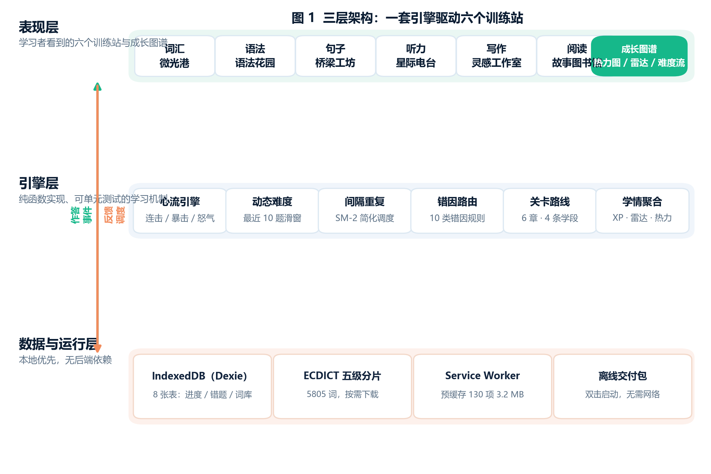
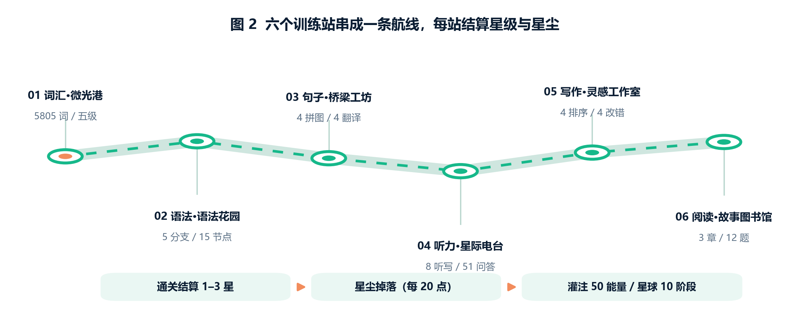
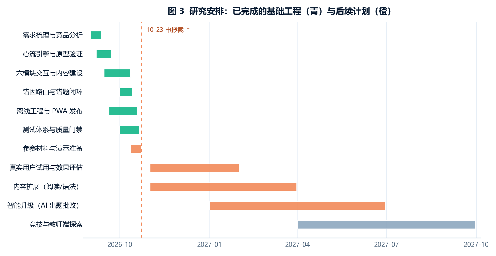

# 微光港：英语星图（FlowVocab）

## 项目介绍文档 · PPT 制作参考

**作品编号：** 452953  
**参赛赛项：** 自主选题类（七）智慧教育与科普创作类赛项  
**成果形态：** Web 应用（PWA，可安装、可离线）  
**线上地址：** https://runner-cpu.github.io/FlowVocab/  
**源码仓库：** https://github.com/runner-cpu/FlowVocab  
**文档版本：** 2026-10-21（对应应用 v3.0.0）

---

## 〇、这份文档怎么用

这不是一份“把功能列一遍”的说明书，而是一份**可以直接拆成 PPT 的论证材料**。全文按答辩逻辑组织：

1. **立题依据**回答“为什么值得做”——痛点是不是真的、现有方案缺什么、研究问题是什么；
2. **研究内容与方法**回答“具体做了什么、凭什么说它是研究而不是堆功能”——六个研究内容、五类方法、一套可复现的质量证据；
3. **创新点与可行性**回答“新在哪、凭什么做得成”——四个创新点逐条对照“原有问题—我们的做法—证据—差异”，再做技术、内容、时间、团队、成本五维可行性；
4. **研究安排及预期成果**回答“走到哪一步、接下来怎么走、最后交付什么”——已完成/在研/后续三段式，配甘特图与量化指标；
5. **PPT 制作建议**给出叙事主线、14 页分镜、视觉规范、3 分钟演示动线和 10 个答辩问题；
6. **附录**给出全部数据口径、代码索引与许可清单，避免答辩时“数字对不上”。

> **使用建议：** 正文中的加粗句可以直接做页面标题；表格可以整表搬进 PPT；每节末尾的“口播”是给主讲人的 30–45 秒讲稿，不是逐字稿。

---

## 一、项目概览：一句话与三个数字

### 1.1 一句话定位

**微光港是一款“把英语备考包装成港口点亮星球”的纯前端学习应用：六个训练站串成一条航线，错因先于答案，复习自动调度，断网也能完整练习。**

### 1.2 三个数字（适合做封面下方的信息条）

| 数字 | 含义 | 证据 |
| --- | --- | --- |
| **6** | 六个训练站：词汇、语法、句子、听力、写作、阅读 | 六个模块均可运行、可结算 |
| **5805** | 分级词库词数，5729 词配真实例句 | ECDICT（MIT）+ Tatoeba（CC-BY 2.0 FR） |
| **566** | 自动化测试总数：524 Vitest + 21 Node 契约 + 21 Python | `npm run validate` 全绿 |

补充两个“工程数字”，适合放在技术页角落：**首屏 JS 399,279 B（gzip 137,120 B，预算 409,600 B）**；**Service Worker 预缓存 113 项、约 3.2 MB**。

### 1.3 作品形态

- 打开网址即用，**免注册、免安装**；
- Chrome / Edge 可一键安装到桌面，iOS 通过“分享 → 添加到主屏幕”安装；
- 安装后以独立窗口运行，**断网可完整练习**；
- 学习进度、错题、复习计划全部写入本机 IndexedDB，**无账号体系、无遥测埋点**。

**口播（20 秒）：** “我们做的不是一个背单词网页，而是一条可以走完的航线。六个训练站、5805 个词、566 项测试，全部跑在浏览器里，不依赖任何服务器。”

---

## 二、立题依据

### 2.1 三个具体的问题，而不是一个抽象的“英语很重要”

立题不从宏大叙事开始，而从团队自己背单词时反复遇到的三件事开始。这三件事分别对应**动机设计、反馈设计、工程约束**三个层面，也构成后面的三条研究线索。

#### 问题一：倒计时把注意力从“学”推向“赶”

主流背词产品普遍用倒计时制造紧迫感：屏幕上跳动的秒数、答错后的时间惩罚、限时闯关。短期看，它提升了单位时间的答题量；长期看，它把学习者的注意力从“这个词为什么是这个意思”转移到“我还剩几秒”。

**可观察的后果：**

- 答错时第一反应是“来不及了”，而不是“我为什么错”；
- 为了赶时间，学习者倾向选择最短的选项、跳过例句、回避需要思考的题；
- 学习动机由外部计时器驱动，一旦离开产品，行为迅速衰减。

这与心流理论的核心条件相悖：心流要求**挑战难度与技能水平匹配**，而不是用外部时钟制造焦虑。真正需要被调节的是“题目难度”，不是“剩余秒数”。

#### 问题二：答错只得到答案，没有得到教学

多数产品对错误的处理是：标红、显示正确答案、进入下一题。学习者获得了一次**判定**，但没有获得一次**教学**。

**可观察的后果：**

- 学习者知道自己错了，但不知道自己错在哪一类：是时态没掌握，是主谓不一致，是冠词漏了，还是形近词混了；
- 同一个知识点换一道题继续错，因为错误从未被归类；
- 错题本只是“题目列表”，不是“可回访的诊断记录”。

从教学设计角度看，这违反了**即时反馈**与**测试效应**的基本原则：反馈不仅要告诉学习者“对/错”，还要解释“为什么”和“下一次怎么做”。

#### 问题三：离开网络就学不了，学习数据也不在自己手里

大量学习工具的词库、例句、复习计划都放在服务器上，必须登录、必须联网。地铁、教室、老旧平板、公共机房——任何一个环节断网，学习就中断。

**可观察的后果：**

- 弱网环境下的学习成本被显著抬高，教育公平受影响；
- 学习记录存放在平台服务器，用户无法真正拥有自己的数据；
- 对未成年人、隐私敏感人群，“无账号、无上传”不是加分项，而是前提条件。

#### 三个问题与研究线索的对应

| 现实问题 | 研究线索 | 对应设计 |
| --- | --- | --- |
| 倒计时造成时间焦虑 | 动机设计：如何不用外部奖惩维持投入 | 连击蓄能、无倒计时、答错不惩罚 |
| 答错只给答案 | 反馈设计：如何把错误转化为教学 | 10 类错因路由、48 组对比卡、错题回流 |
| 断网即中断、数据不在本机 | 工程约束下的智能：无后端如何个性化 | 纯前端引擎、IndexedDB、PWA 离线、词库分片 |

> **PPT 用法：** 这一页不要放三列文字，建议做成“三个场景截图 + 三句用户原话”的形式。场景可以是：地铁里断网、答错后只剩一个红叉、倒计时还剩 3 秒。

### 2.2 现有方案为什么不够：竞品功能拆解

我们在 2026 年 9 月对公开版本的主流产品做了一次功能拆解。**这不是严格意义上的竞品评测，而是一次设计参照**：只看“错误反馈、激励方式、离线能力、数据归属”四个维度。

| 维度 | 打卡型背词产品（百词斩/扇贝/不背单词等） | 通用记忆工具（Anki） | 游戏化语言产品（多邻国） | 微光港 |
| --- | --- | --- | --- | --- |
| 错误反馈 | 多为“正确答案 + 释义” | 依赖用户自建卡片，无自动归因 | 有即时判定，错因解释有限 | **10 类错因 + 规则讲解 + 形近词对比卡 + 错题回流** |
| 激励方式 | 打卡、连续天数、排行榜 | 无内置激励 | 连胜、宝石、排行榜 | **连击蓄能、无倒计时、答错只断连不扣资源** |
| 离线能力 | 部分词库可离线，功能受限 | 桌面端可离线 | 基本依赖网络 | **整站 PWA 预缓存，六模块离线可练** |
| 数据归属 | 平台账号 | 本地/自建同步 | 平台账号 | **本机 IndexedDB，无账号、无上传** |
| 叙事与路径 | 列表式词书 | 牌组式 | 关卡地图 | **六站航线 + 星尘灌注 + 10 阶段星球** |

**结论不是“别人都不好”，而是：四个维度同时满足的产品很少。** 打卡型产品强在内容与习惯，弱在错因教学；Anki 强在调度，弱在内容与激励；多邻国强在游戏化，弱在离线与数据本地。微光港选择了一个明确的组合：**错因教学 × 无焦虑激励 × 离线优先 × 叙事化路径**。

> **答辩提示：** 如果评委追问“你凭什么说别人没有”，要主动降低姿态：这是公开版本的功能观察，不构成对任何产品的完整评价；我们的差异是设计取舍，不是优劣判断。

### 2.3 理论与政策依据

#### 学习科学依据

| 理论/机制 | 核心结论 | 在作品中的落地 |
| --- | --- | --- |
| 间隔重复（Ebbinghaus 遗忘曲线、SM-2） | 在遗忘临界点复习，效率高于集中重复 | 复习间隔 [1, 3, 7, 15, 30] 天，连续 3 次成功记为掌握 |
| 测试效应（Testing Effect） | 提取练习比重复阅读更能促进长期记忆 | 全部模块以“作答”为核心，而非“阅读讲解” |
| 心流理论（Csikszentmihalyi） | 挑战与技能匹配时进入心流 | 最近 10 题正确率 >85% 升档、<60% 降档 |
| 即时反馈 | 反馈越及时，修正越有效 | 判定后立即给出错因卡与对比卡 |
| 自我决定理论（SDT） | 自主、胜任、归属提升内在动机 | 自定节奏、可见成长、旅伴叙事 |

#### 政策与课标背景

- 《教育信息化 2.0 行动计划》强调信息技术与教育教学深度融合；
- 《义务教育英语课程标准（2022 年版）》强调学习策略、自主学习能力与真实语境中的语言运用；
- “双减”之后，课后自主学习与家庭教育场景增加，轻量、即开即用、数据可控的工具需求上升。

> **注意：** 这一部分只做背景铺垫，不要写成“政策要求我们必须做这个产品”。答辩时更稳的说法是：“我们的设计方向与课标强调的自主学习、学习策略是一致的。”

### 2.4 研究问题

把三个具体问题转成三个可研究、可验证的问题：

- **RQ1（动机）：** 在不使用倒计时、排行榜和外部奖惩的前提下，如何让学习者愿意持续投入？
- **RQ2（反馈）：** 如何把一次错误自动转化为可理解、可执行、可回访的教学反馈？
- **RQ3（工程）：** 在纯前端、无账号、可离线的约束下，如何实现个性化调度与学习数据留存？

三个问题共同指向一个总目标：

> **构建一个“低压力、高反馈、可离线”的英语自主学习环境，并用可运行的作品与可复现的测试证明它成立。**

### 2.5 研究目标（可检验）

| 目标 | 检验方式 | 当前状态 |
| --- | --- | --- |
| 六个模块形成完整学习闭环 | 每模块可进入、可作答、可结算、可回访 | 已完成 |
| 错误能被自动归因并给出教学反馈 | 10 类错因规则 + 单元测试覆盖 | 已完成 |
| 难度能随表现动态校准 | 5 档难度、10 题滑动窗口、曲线可回看 | 已完成 |
| 复习能按遗忘曲线自动调度 | 到期词进入队列、连续 3 次记为掌握 | 已完成 |
| 断网可完整练习 | DevTools Offline 刷新后六模块可用 | 已完成 |
| 质量可复现 | `npm run validate` 一条命令全绿 | 已完成 |

**口播（40 秒）：** “我们没有从‘英语学习很重要’讲起，而是从三个很具体的挫败感讲起：倒计时让人分心、答错只给答案、断网就学不了。把这三个问题转成三个研究问题——动机、反馈、工程约束——后面的所有设计，都是对这三个问题的回答。”

---

## 三、研究内容与方法

### 3.1 总体研究框架

作品采用“**内容层—引擎层—交互层—数据层**”四层结构，研究内容围绕“一条主线、三个机制、一个底座”展开：

```
一条主线：六个训练站串成的学习航线（叙事化路径）
三个机制：心流引擎（动机） / 错因路由（反馈） / 间隔重复（记忆）
一个底座：纯前端 + IndexedDB + PWA 离线（工程约束下的智能）
```



**图 1 说明：** 上层是六个训练站与成长图谱；中层是六个纯函数引擎（连击、难度、遗忘、错因、选项去偏、成长）；下层是 8 张 IndexedDB 表、5805 词分片词库、113 项预缓存与离线启动能力。三层之间只通过“作答事件”和“反馈调度”两条通道通信，因此**换内容不需要改引擎，换引擎不需要改界面**。

### 3.2 研究内容一：内容体系与四条学段路线

#### 内容规模

| 内容类型 | 规模 | 来源/性质 |
| --- | --- | --- |
| 词汇 | 5805 词，五级分片；5729 词配例句；词性覆盖 99.07% | ECDICT（MIT）+ Tatoeba（CC-BY 2.0 FR） |
| 语法 | 5 大分支、15 个知识节点、30 道判断题 | 团队原创 |
| 句子 | 4 道长难句拼图 + 4 道翻译对决 | 团队原创 |
| 听力 | 8 段听写 + 10 个语音场景（51 组问答） | 团队原创 |
| 写作 | 4 道句子排序 + 4 道改错 | 团队原创 |
| 阅读 | 3 章原创叙事 + 12 道考点题 | 团队原创 |
| 辅助 | 48 组形近词对比卡、72 张小学图像词卡 | 团队整理 |

#### 四条学段路线

| 路线 | 对应人群 | 内容范围 |
| --- | --- | --- |
| 小学 | 小学高年级 | 基础词、图像词卡、简单句 |
| 初高中 | 初高中 | 中考/高考核心词、基础语法体系 |
| 进阶 | 大学/成人 | 六级、考研、长难句 |
| 四六级 | 备考人群 | CET4/CET6 高频词与题型 |

路线不是四套独立产品，而是**同一套引擎 + 不同内容配置**。这样增加学段或语种时，不需要改交互层。

#### 内容质量如何保证

内容不靠“人工目测”，而是把质量问题变成可重复执行的检查：

- `scripts/validate-content.mjs`：校验词库结构、词性覆盖、题目字段完整性；
- `src/data/grammar.test.ts`：用分词与 Jaccard 相似度检查“例句不能被直接抄成答案”；
- `src/data/reading.test.ts`：检查选项标签不得包含正确答案；
- 语法节点做“前缀闭包”校验：子节点开放前，父节点必须已开放，避免路线出现断点。

> **PPT 用法：** 这一页适合用“内容规模气泡图”或“四路线矩阵”，不要堆六行文字。可以说一句：“我们的内容不是空壳，5805 个词、5729 个例句、51 组听力问答，全部可在线验证。”

### 3.3 研究内容二：心流引擎——不用倒计时，如何维持投入

#### 连击 / 暴击 / 怒气（`src/engine/combo.ts`）

```
正确作答 → 连击 +1
  用时 < 中位数 × 0.7 → 暴击（双倍经验）
  连击达到 5 的倍数 → 怒气爆发：接下来 3 次作答双倍经验
  怒气中答对 → 消耗 1 次；答错 → 怒气结束
错误作答 → 连击归零（只归零，不扣资源）
```

三个设计取舍：

1. **没有倒计时。** 节奏由学习者掌握，压力来自“要不要再答一题”，而不是“还剩几秒”。
2. **答错不惩罚资源。** 连击断了只是少赚，不会扣经验、不会让星球枯萎。这直接对应“正向延迟满足”。
3. **提示有代价。** 使用提示后该题经验减半，避免提示变成免费答案。

#### 自适应难度（`src/engine/difficulty.ts`）

```
滑动窗口：最近 10 次作答
正确率 > 85% 且超慢占比 < 40% → 升档
正确率 < 60% 或超慢占比 > 60% → 降档
否则 → 保持
5 档：四级核心 → 四级高频 → 六级 → 六级高频 → 考研超纲
```

难度不是“越难越好”，而是把正确率维持在“跳一跳够得着”的区间。每次难度变化都会记录成一条曲线，在成长图谱里可回看。

#### 成长与结算

- 每章按正确率给 1–3 星（≥90% 三星、≥70% 两星、≥40% 一星）；
- 只记录最好成绩，重玩不会降低评价；
- 一轮内 ≥80% 且最高连击 ≥5，同样可拿三星（连击补偿）；
- 星尘每 20 点可灌注 50 星球能量，星球共 10 个阶段；
- XP 等级阈值：[0, 500, 1500, 3200, 5600, 8500, 12000, 16200, 21000, 26400]。

> **口播（30 秒）：** “我们删掉了倒计时，不是因为它难做，而是因为它和我们的目标相反。取而代之的是连击蓄能：每 5 连击给 3 次双倍经验，答错只断连、不扣资源。压力还在，但压力来自挑战本身，不来自时钟。”

### 3.4 研究内容三：间隔重复——让复习发生在遗忘之前

#### 简化版 SM-2（`src/engine/forget.ts`）

```
质量评分 q ∈ {0, 1, 2}：错 = 0；对但慢 = 1；快而准 = 2
复习间隔：[1, 3, 7, 15, 30] 天
状态：new → learning → mastered（连续 3 次质量 ≥1）
```

#### 与词汇模块的联动

- 答错的词自动进入词林，按到期时间优先出题；
- 首页显示“今日到期”数量；
- 词林按记忆健康度分档，学习者能看到“哪些词快忘了”；
- 复习同样计入 XP 与成长，不会因为“只是复习”而被区别对待。

#### 为什么是“简化版”

完整 SM-2 需要用户对每次复习打 0–5 分，普通学习者很难稳定自评。我们把评分压缩成三个可观测量：对/错、快/慢。代价是精度略低，收益是**不需要用户学习一套评分规则**，这在自学场景里更重要。

### 3.5 研究内容四：错因路由——把一次错误变成一次讲解

这是作品最核心的创新点，单独展开。

#### 问题

答错后只显示正确答案，学习者得到的是“判定”，不是“教学”。

#### 方法：可观测信号 → 稳定标签 → 规则卡

`src/engine/errorRouting.ts` 是一个**纯函数**：输入模块、题型、题干、选项、作答、正确答案、目标词等可观测信号，输出 10 类错因标签之一，并给出对应的中文规则卡。

| 错因标签 | 中文名 | 典型触发信号 |
| --- | --- | --- |
| `tense` | 时态 | 题干含时间状语、动词形式变化 |
| `agreement` | 主谓一致 | 主语单复数与谓语不匹配 |
| `article` | 冠词 | a/an/the 缺失或误用 |
| `preposition` | 介词 | 固定搭配中的介词错误 |
| `word-choice` | 词义辨析 | 形近词、近义词混淆 |
| `word-form` | 词形变化 | 词性、派生词、屈折变化 |
| `clause` | 从句 | 关系词、连接词、语序 |
| `spelling` | 拼写 | 拼写模式与目标词不一致 |
| `listening-detail` | 听力细节 | 听力材料中的数字、地点、时间 |
| `generic` | 综合 | 信号不足时的安全降级 |

三个工程约束：

1. **纯函数、无副作用、无随机、无时间依赖**：同样入参永远得到同样标签，便于测试与复现。
2. **残缺数据一律降级为 `generic`，绝不抛错**：真实学习数据经常缺字段，引擎必须先保证不崩。
3. **启发式只在填空型练习启用**：避免把阅读理解里恰好以 `which` 或 `-ed` 结尾的选项误判成语法考点。

#### 教学闭环

```
答错 → 归因（10 类）→ 规则讲解 → 匹配 48 组形近词对比卡
     → 写入错题本（同题重复答错只累加次数，答对自动移出）
     → 成长图谱按最近答错时间列出题干、错因、正确答案
     → 点一条回到那道题本身重练
```

错题本上限 80 条，防止无限膨胀；六个模块共用同一套错因卡，听力选词也走同一条路径。

> **口播（35 秒）：** “答错之后，我们不是只给一个红叉，而是先问‘为什么错’。系统按 10 类错因归因，给一张规则卡，再配一张形近词对比卡。错题不会答完就消失，它会留在错题本里，点一下就能回到那道题重练。”

### 3.6 研究内容五：离线优先——把“智能”放进浏览器

#### 三层离线策略

| 层级 | 策略 | 说明 |
| --- | --- | --- |
| 应用外壳 | Service Worker 预缓存 113 项、约 3.2 MB | 首屏与六个模块离线可用 |
| 词库 | 五级分片、按需下载（约 2.2 MB） | 首次进入词汇模块时加载，之后离线可用 |
| 学习数据 | IndexedDB 8 张表 | 进度、错题、复习计划、统计全部本机 |

#### 8 张表

| 表 | 作用 |
| --- | --- |
| `userProfile` | 用户档案、XP、最佳连击、设置 |
| `userWords` | 每个词的学习状态与复习调度 |
| `dailyStats` | 每日 XP/能量/连击/分模块计数 |
| `sessions` | 每次练习会话（含难度流） |
| `progress` | 六维雷达、技能树、写作日志 |
| `planet` | 星球能量/等级/每日目标 |
| `wordBank` | 词库主数据（ECDICT 五级分片） |
| `wordBankMeta` | 词库版本信息 |

#### 渐进增强，而不是“全有或全无”

- 语音识别由浏览器提供；不支持或拒绝麦克风时，自动切换为**打字输入**，评分路径完全一致；
- 图表都提供**原生数据表替代视图**与键盘可达入口；
- 词库加载失败时保留已缓存词，并显示可重试提示；
- 新版本发布后，页面导航走网络优先，避免用户长期停在旧版本；练习中的标签页不会被强制刷新。

#### 为什么这算“智能”

“智能”不一定等于大模型。在无后端、无账号的约束下，仍然可以实现：

- 自适应难度（基于滑动窗口的实时校准）；
- 间隔重复（基于遗忘曲线的调度）；
- 错因归因（基于可观测信号的规则推理）；
- 语音评分（基于关键词命中与置信度的规则评分）。

这些机制全部在本地运行，**不上传音频、不上传学习记录**，响应时间也不受网络影响。

> **PPT 用法：** 这一页建议用“三层离线”示意图（外壳/词库/数据），再配一张 DevTools 断网刷新后的截图。现场演示比文字更有说服力。

### 3.7 研究内容六：叙事化路径与成长可视化

#### 六站航线



**图 2 说明：** 六个训练站沿暮色海港航线排布，每站有独立场景、章节目标与结算；通关后点亮灯塔、掉落星尘；星尘在工坊灌注成星球能量，推动 10 个阶段的星球成长。

#### 成长图谱（ECharts 按需加载）

| 图表 | 回答的问题 | 交互 |
| --- | --- | --- |
| 90 天热力图 | 我最近学得怎么样？ | 点击任意一天下钻当日 XP/能量/连击/各模块题量 |
| 六维雷达 | 我哪一项弱？ | 悬停读数、点击维度直接进入该模块 |
| 难度流 | 我的心流质量如何？ | 悬停显示当时档位 |
| 星球成长 | 我离下一阶段还差多少？ | 进度条显示能量差 |

每个图表都带原生数据表替代视图，避免“只有视觉、没有数据”。

#### 学习引擎说明面板

在成长图谱页有一个紧凑面板，用 30 秒讲清四件事：自适应难度如何校准、SM-2 如何安排复习窗、错因如何路由、连击激励为何取消倒计时。这个面板是**给评委和新用户看的“教学设计呈现层”**，把隐性的机制显性化。

### 3.8 研究方法

| 方法 | 具体做法 | 产出/证据 |
| --- | --- | --- |
| 设计科学研究（DSR） | 问题定义 → 设计 → 实现 → 验证 → 迭代 | 69 次提交、45 天迭代记录 |
| 文献与理论映射 | 心流、间隔重复、测试效应、自我决定理论 | 机制与理论对照表 |
| 竞品功能拆解 | 四维度观察公开版本 | 竞品对照矩阵 |
| 迭代开发与自动化回归 | 每次提交跑 `npm run validate` | 566 项测试、发布门禁 |
| 启发式可用性走查 | Nielsen 十原则 + 键盘走查 + 深浅色走查 | 参赛就绪度审查报告 |
| 内容校验 | 脚本 + 单元测试 + 相似度检查 | 词性覆盖 99.07%、内容校验全绿 |
| 参数标定 | 以中位作答时间为基准，窗口 10 题 | 难度与暴击阈值可解释 |
| 离线与弱网测试 | DevTools Offline、断网刷新、离线包 | 六模块离线可用 |

### 3.9 技术架构

| 层次 | 方案 | 职责 |
| --- | --- | --- |
| 构建 | Vite 6 + TypeScript 5.6 | 开发服务器、静态构建、代码分割 |
| UI | React 18（函数组件 + Hooks） | 六模块与仪表盘 |
| 状态 | Zustand | 游戏态（连击/怒气/难度）、会话态 |
| 持久化 | Dexie.js（IndexedDB） | 词库、进度、错题、统计 |
| 可视化 | ECharts（按需引入） | 热力图、雷达、难度流 |
| 音效 | Web Audio API（合成器） | 零资源、零版权音效 |
| 语音 | Web Speech API | 朗读 + 跟读识别（渐进增强） |
| 部署 | GitHub Pages + GitHub Actions | 推送即检查、合并即部署 |

**代码组织：** `src/engine` 放纯函数（判分、难度、遗忘、错因、选项去偏、成长）；`src/data` 放内容；`src/components` 按模块拆分。纯函数层便于单元测试，也便于替换内容而不动交互。

### 3.10 质量保障与评测方法

#### 一条命令的质量门禁

```bash
npm run validate
# 类型检查 → lint → 524 项 Vitest → 21 项 Python 内容测试
# → 构建 → 首屏体积预算 → 21 项 Node 契约测试 → 内容校验
```

任何一项失败都不能发布。GitHub Actions 在每次推送后执行同一套检查并部署 Pages。

#### 测试构成

| 类型 | 数量 | 覆盖内容 |
| --- | --- | --- |
| Vitest 单元/组件 | 524（60 个文件） | 引擎、数据、组件、交互、可访问性 |
| Node 契约测试 | 21 | Service Worker、离线契约、PWA 资源、设计一致性、启动兜底 |
| Python 内容测试 | 21 | 词库结构、词性覆盖、题目字段完整性 |
| **合计** | **566** | — |

#### 性能与体积

| 指标 | 当前值 | 预算/阈值 |
| --- | --- | --- |
| 初始 JS（完整模块图） | 399,279 B | ≤ 409,600 B |
| 初始 JS gzip | 137,120 B | — |
| 预缓存资源 | 113 项，约 3.2 MB | — |
| 代码规模 | 156 个 TS/TSX 文件，15,263 行 | — |

> **口播（30 秒）：** “我们不是靠‘看起来完成了’来判断完成度，而是靠一条命令：类型、lint、566 项测试、构建、体积预算、离线契约、内容校验，任何一项失败都不能发布。这是我们认为‘完成度’可以被验证的方式。”

---

## 四、创新点与可行性

### 4.1 创新点总览

| 序号 | 创新点 | 一句话 | 对应研究问题 |
| --- | --- | --- | --- |
| 1 | **错因先于答案** | 答错后先归因，再给规则讲解与对比卡，错题可回访 | RQ2 |
| 2 | **无倒计时的连击蓄能** | 用连击而非时钟制造节奏，答错只断连不扣资源 | RQ1 |
| 3 | **离线优先的本地智能** | 整站 PWA + IndexedDB + 本地规则引擎，断网可练、数据在本机 | RQ3 |
| 4 | **叙事化学习路径** | 六站航线、星尘灌注、10 阶段星球，把进度变成可回看的地图 | RQ1 |
| 5 | **可验证的工程质量**（支撑性） | 566 项测试 + 发布门禁 + 体积预算，把“完成度”变成可复现证据 | RQ3 |

### 4.2 创新点一：错因先于答案

| 项 | 内容 |
| --- | --- |
| **原有问题** | 答错只显示正确答案，学习者得到判定而非教学 |
| **我们的做法** | 10 类错因路由 + 规则讲解 + 48 组形近词对比卡 + 错题回流 |
| **技术实现** | `src/engine/errorRouting.ts` 纯函数；六模块共用；残缺数据降级为 `generic` |
| **证据** | 单元测试覆盖归因规则；错题本上限 80；成长图谱可按最近答错时间回访 |
| **与既有成果的差异** | 竞品多为“答案 + 释义”，我们把“错因”作为一等数据 |

**为什么难被复制：** 错因不是一个大模型接口就能解决的——它需要把“题目结构、选项形状、作答文本、模块语境”组合成稳定规则，还要保证误判不会破坏体验。我们的做法是可解释、可测试、可离线运行的。

### 4.3 创新点二：无倒计时的连击蓄能

| 项 | 内容 |
| --- | --- |
| **原有问题** | 倒计时短期提升答题量，长期消耗学习动机 |
| **我们的做法** | 5 连击 → 接下来 3 次双倍经验；答错只断连、不扣资源；星球不枯萎 |
| **技术实现** | `src/engine/combo.ts`；连击上限与最佳连击进入成长数据 |
| **证据** | 单局时长由作答节奏决定；连击/暴击/怒气均有单元测试 |
| **差异** | 多数游戏化产品用“损失厌恶”驱动，我们用“胜任感”驱动 |

**教育含义：** 这不是“去掉难度”，而是把压力从“时间”转移到“挑战”。学习者可以选择慢慢想，也可以选择挑战更高难度；两种选择都不会被惩罚。

### 4.4 创新点三：离线优先的本地智能

| 项 | 内容 |
| --- | --- |
| **原有问题** | 学习工具依赖账号与网络，弱网不可用，数据在平台 |
| **我们的做法** | 整站 PWA；113 项预缓存；词库五级分片懒加载；IndexedDB 8 表；本地规则引擎 |
| **技术实现** | Service Worker 网络优先导航 + 缓存优先静态资源；词库 stale-while-revalidate |
| **证据** | DevTools Offline 刷新可答题；`npm run pack:offline` 可生成双击即用的离线包 |
| **差异** | 在普遍依赖云端的参赛作品里，离线是清晰的差异化，也是现场演示的保险 |

**边界说明：** 清除浏览器数据会同时清除学习记录；跨设备同步未做；教师端班级视图需要后端，当前不在范围内。这些都在设置页与文档中如实写出。

### 4.5 创新点四：叙事化学习路径

| 项 | 内容 |
| --- | --- |
| **原有问题** | 六个模块做成六个互不相干的入口，学习者缺少“走到哪里了”的整体感 |
| **我们的做法** | 暮色海港航线 + 六座灯塔 + 星尘工坊 + 10 阶段星球 |
| **技术实现** | 航线地图、章节解锁、星级结算、星尘掉落、能量灌注 |
| **证据** | 六个模块都接入航线与结算；成长图谱可回看 |
| **差异** | 不是抽象进度条，而是一张可以回看的地图 |

### 4.6 创新点五（支撑性）：可验证的工程质量

- `npm run validate` 一条命令覆盖类型、lint、测试、构建、体积、契约、内容；
- 首屏预算 409,600 B，当前 399,279 B，留有余量；
- 21 项 Node 契约测试专门检查 Service Worker、离线契约、PWA 资源、设计一致性、启动兜底；
- GitHub Actions 每次推送执行同一套检查并部署。

**这一点的意义：** 参赛作品常见的问题是“演示时能跑，换台机器就崩”。我们把“能跑”拆成可复现的检查，让评审可以在任何一台机器上验证。

### 4.7 与竞品的差异总结（答辩用一句话）

> **别人把学习做成“打卡 + 题库”，我们把学习做成“诊断 + 调度 + 叙事”。**

更稳的版本：

> **我们的差异不在功能数量，而在三个取舍：用错因代替答案、用连击代替倒计时、用本地代替云端。**

### 4.8 可行性分析

#### 技术可行性

| 维度 | 判断 | 依据 |
| --- | --- | --- |
| 技术栈成熟度 | 高 | React 18 / TypeScript / Vite / Zustand / Dexie / ECharts 均为成熟方案 |
| 纯前端能力边界 | 已覆盖核心需求 | 判分、调度、归因、可视化均可在浏览器完成 |
| 离线能力 | 已验证 | Service Worker + IndexedDB + 词库分片 |
| 浏览器兼容 | 主流可用，降级明确 | Chrome/Edge 完整；其他浏览器听力降级为选词；移动端响应式 |
| 部署成本 | 零服务器成本 | GitHub Pages 静态托管 |

#### 内容可行性

- 词库来自 ECDICT（MIT），可商用、可再分发；
- 例句来自 Tatoeba（CC-BY 2.0 FR），逐句可溯源；
- 语法、句子、听力、写作、阅读为团队原创；
- 内容校验脚本保证扩展时不破坏既有质量；
- 词性覆盖 99.07%，5729/5805 词配例句。

#### 时间可行性

- 2026-09-07 至 2026-10-21，45 天、69 次提交，已完成六个模块、引擎、离线与测试；
- 剩余工作主要是参赛材料定稿、演示视频录制、报名提交；
- 关键路径清晰：材料 → 视频 → 提交，均有缓冲。

#### 团队可行性

| 角色 | 主要工作 | 已完成的实际成果 |
| --- | --- | --- |
| 程序开发 | 架构、六模块交互、判分与难度引擎、复习调度、Service Worker、发布门禁 | 全部代码与测试 |
| 视觉设计 | 品牌标识、色彩与排版令牌、六站场景与图标、深色主题、响应式与无障碍 | 设计系统与界面 |
| 内容制作 | 词库清洗与分级、五类原创内容、48 组对比卡、72 张词卡、内容校验 | 全部内容数据 |

三位成员共同完成选题、交互流程设计与测试验收。团队信息与指导教师信息以报名系统最终填写为准。

#### 成本可行性

| 项目 | 成本 |
| --- | --- |
| 服务器 | 0（纯静态托管） |
| 数据库 | 0（本机 IndexedDB） |
| 域名 | 0（GitHub Pages 子域） |
| 第三方素材 | 0（MIT / CC-BY / OFL，均合规） |
| 维护 | 低（无后端、无账号体系） |

### 4.9 风险与应对

| 风险 | 影响 | 应对 |
| --- | --- | --- |
| AI 辅助插画的合规披露 | 评审质疑原创性 | 已在《人工智能工具使用情况说明》中逐项披露工具、环节、人工处理；插画与文案初稿均经人工筛选、统一色调、重采样与审校 |
| 无真实用户试用数据 | “效果”难量化 | 如实说明当前只有自测与自动化测试证据；后续计划开展小规模试用与前后测 |
| 单机无班级/教师端 | 课堂场景受限 | 明确定位为个人自学 + 弱网场景；班级端列为后续计划，不冒充已完成 |
| 浏览器语音差异 | 跟读体验不一致 | 提供打字输入降级；评分定位为“练习参考”，不是发音能力测评 |
| 内容深度边界 | 四六级深层语法未全开放 | 在路线规划中如实列出未开放条目，并指路可练路线 |
| 学习数据丢失 | 清除浏览器数据即丢失 | 设置页明确提示；提供本机数据导出/导入；后续探索端到端加密同步 |
| 演示现场网络故障 | 影响展示 | 离线包 + PWA 缓存，断网也能完整演示 |

**口播（40 秒）：** “可行性不是‘我们觉得能做’，而是四件事已经发生：作品已经上线、566 项测试已经全绿、离线已经验证、成本几乎为零。风险也有，我们把它写在文档里，而不是藏起来。”

---

## 五、研究安排及预期成果

### 5.1 研究阶段与时间安排



**图 3 说明：** 青色为 2026-09 至 2026-10-21 已完成的基础工程；橙色为 2026-10-12 之后的参赛材料与后续研究计划；虚线为 2026-10-23 申报截止。

| 阶段 | 时间 | 主要工作 | 状态 |
| --- | --- | --- | --- |
| 0 需求与设计 | 2026-09-01 – 09-12 | 痛点梳理、竞品拆解、信息架构、设计令牌 | 已完成 |
| 1 心流引擎与原型 | 2026-09-07 – 09-22 | 连击/暴击/怒气、难度阀门、原型验证 | 已完成 |
| 2 六模块与内容建设 | 2026-09-15 – 10-12 | 六模块交互、5805 词、五类原创内容 | 已完成 |
| 3 错因路由与错题闭环 | 2026-10-01 – 10-14 | 10 类错因、48 组对比卡、错题回流 | 已完成 |
| 4 离线工程与 PWA 发布 | 2026-09-20 – 10-19 | Service Worker、词库分片、离线包、Pages 部署 | 已完成 |
| 5 测试体系与质量门禁 | 2026-10-01 – 10-21 | 566 项测试、体积预算、契约测试、内容校验 | 已完成 |
| 6 参赛材料与演示准备 | 2026-10-12 – 10-23 | 作品文档、演示视频、原创声明、AI 使用说明、报名提交 | 进行中 |
| 7 真实用户试用与效果评估 | 2026-11 – 2027-01 | 小规模试用、前后测、可用性访谈 | 计划 |
| 8 内容扩展（阅读/语法） | 2026-11 – 2027-03 | 初高中与四六级阅读篇章、语法节点补齐 | 计划 |
| 9 智能升级（AI 出题/批改） | 2027-01 – 2027-06 | AI 出题、错题讲解、写作批改（在合规前提下） | 计划 |
| 10 竞技与教师端探索 | 2027-04 – 2027-09 | 联机对战、ELO 段位、班级视图（需后端） | 计划 |

### 5.2 已完成工作清单（截至 2026-10-21）

#### 产品与功能

- 六个训练模块全部可运行、可结算；
- 星级、星尘、连击、错因卡、错题回顾、语音陪练、复习调度均已实现；
- 四条学段路线内容已划开；
- PWA 安装与离线练习可用；
- `npm run pack:offline` 可生成含本地启动脚本的离线交付包。

#### 内容

- 5805 词、5729 例句、词性覆盖 99.07%；
- 15 个语法节点与 30 题；
- 8 组句子题；
- 8 段听写 + 10 个对话场景（51 组问答）；
- 8 个写作任务；
- 3 章阅读 + 12 题；
- 48 组对比卡、72 张词卡。

#### 工程与质量

- 566 项自动化测试全部通过；
- `npm run validate` 发布门禁；
- 首屏 JS 399,279 B（gzip 137,120 B），低于 409,600 B 预算；
- 113 项预缓存、约 3.2 MB；
- GitHub Actions 自动检查与部署；
- 156 个 TS/TSX 文件、15,263 行代码、69 次提交。

#### 文档与合规

- 作品介绍文档、演示视频脚本、AI 工具使用说明、原创性与知识产权声明准备清单、第三方资源说明、测试与质量报告；
- 应用内“关于与许可”区展示三条素材许可与三条隐私说明；
- 图标、分享卡、PWA manifest 齐备。

### 5.3 预期成果

#### 直接成果（本次参赛）

| 成果 | 形态 | 状态 |
| --- | --- | --- |
| 可运行的 Web 应用 | 线上 PWA + 离线交付包 | 已完成 |
| 作品介绍文档 | 本文档及申报版 | 已完成/定稿中 |
| 演示视频 | 3 分钟分镜脚本 + 录制 | 脚本已备，录制中 |
| 原创性与知识产权声明 | 报名系统提交 | 准备中 |
| AI 工具使用情况说明 | 文档 | 已完成 |
| 第三方资源说明 | 文档 | 已完成 |
| 测试与质量报告 | 文档 + 可复现命令 | 已完成 |

#### 衍生成果（计划）

| 成果 | 说明 | 时间 |
| --- | --- | --- |
| 软件著作权登记 | 以现有代码与文档申请 | 2026-11 起 |
| 教学技术论文/案例 | 以“错因路由 + 无焦虑激励”为主题 | 2027 年上半年 |
| 小规模试用报告 | 20–50 名学习者，前后测 + 访谈 | 2027-01 前 |
| 离线交付包 | 面向弱网学校的分发版本 | 已完成初版 |

> **注意：** “衍生成果”是计划，不是已完成。答辩时要明确区分，避免被追问“论文发了吗”。

### 5.4 成果评价指标（可量化）

| 维度 | 指标 | 目标值 | 当前值 |
| --- | --- | --- | --- |
| 功能完整 | 六模块可运行、可结算 | 6/6 | 6/6 |
| 内容规模 | 词库词数 | ≥5000 | 5805 |
| 内容质量 | 词性覆盖率 | ≥95% | 99.07% |
| 学习机制 | 错因类别 | ≥8 | 10 |
| 学习机制 | 复习间隔档位 | ≥5 | 5 |
| 学习机制 | 难度档位 | ≥5 | 5 |
| 工程质量 | 自动化测试 | ≥500 | 566 |
| 工程质量 | 首屏 JS 预算 | ≤409,600 B | 399,279 B |
| 工程质量 | 预缓存资源 | ≥100 项 | 113 项 |
| 离线能力 | 断网可练模块 | 6/6 | 6/6 |
| 可用性 | 桌面一屏显示完整题目 | 1920×1080 / 1440×900 | 已验收 |
| 可访问性 | 键盘作答 | 六模块支持 | 已支持 |

### 5.5 后续研究计划（按优先级）

1. **真实用户试用与效果评估**（最高优先级）：20–50 名学习者，2–4 周，前后测 + 访谈，重点验证“错因卡是否真的帮助修正”。
2. **内容扩展**：初高中与四六级阅读篇章、语法节点补齐；听力增加英音/美音切换。
3. **智能升级**：在不引入账号的前提下，探索端到端加密的可选同步；AI 出题与写作批改作为辅助，不替代规则引擎。
4. **教师端与班级视图**：需要后端，作为独立产品线评估，不混入当前版本。
5. **竞技与社交**：联机对战、ELO 段位，需先解决反作弊与服务器成本。

**口播（35 秒）：** “我们的安排分三段：9 月到 10 月 21 日，把基础工程做完；10 月 12 日到 23 日，把参赛材料做完；11 月之后，做真实用户试用、内容扩展和智能升级。已经完成的用青色，计划中的用橙色，不混在一起讲。”

---

## 六、PPT 制作建议

### 6.1 叙事主线：三幕结构

| 幕 | 主题 | 回答的问题 | 对应页 |
| --- | --- | --- | --- |
| 第一幕 | 问题 | 为什么现有学习工具让人学不下去？ | 2–5 |
| 第二幕 | 方案 | 我们怎么把这三个问题分别解决？ | 6–11 |
| 第三幕 | 证据 | 凭什么说它做成了、做得成？ | 12–14 |

**一句话主线：** “从三个具体的挫败感出发，做一个低压力、高反馈、可离线的学习环境，并用可运行的作品和可复现的测试证明它。”

### 6.2 14 页分镜表

| 页 | 标题（可直接用） | 核心信息 | 页面元素 | 口播时长 |
| --- | --- | --- | --- | --- |
| 1 | 微光港：英语星图 | 不背单词，打游戏顺便过级 | 深色海港主视觉 + 作品名 + 一行副标题 + 网址 | 15s |
| 2 | 三个数字，先看结果 | 6 个训练站 / 5805 词 / 566 项测试 | 三个大数字 + 一条信息条 | 20s |
| 3 | 我们遇到的三个问题 | 倒计时分心、答错只给答案、断网学不了 | 三张场景图 + 三句用户原话 | 45s |
| 4 | 现有方案为什么不够 | 四个维度同时满足的产品很少 | 竞品对照矩阵（四行五列） | 40s |
| 5 | 三个研究问题 | 动机、反馈、工程约束 | 三个问题卡片 + 总目标 | 30s |
| 6 | 一条航线，六个训练站 | 六站串成完整学习路径 | 航线图（图 2）+ 六站名称 | 35s |
| 7 | 一次作答，五次复用 | 作答 → 判定 → 错因 → 复习 → 成长 | 闭环流程图（五节点） | 35s |
| 8 | 心流引擎：不用倒计时 | 连击蓄能 + 5 档难度 + 星级结算 | 三张小图：连击曲线、难度阀门、星级 | 45s |
| 9 | 错因先于答案 | 10 类错因 + 48 组对比卡 + 错题回流 | 错因卡截图 + 10 标签云 + 闭环箭头 | 50s |
| 10 | 离线优先：把智能放进浏览器 | PWA + IndexedDB + 本地规则引擎 | 三层离线图（图 1）+ 断网截图 | 45s |
| 11 | 四个创新点 | 错因、无焦虑、离线、叙事 | 四象限卡片，每卡一句证据 | 40s |
| 12 | 完成度可以被验证 | 566 项测试 + 发布门禁 + 体积预算 | 测试构成表 + `validate` 截图 | 40s |
| 13 | 研究安排 | 已完成基础工程，后续三段计划 | 甘特图（图 3） | 35s |
| 14 | 预期成果与价值 | 作品、文档、试用、衍生成果 | 成果清单 + 应用价值三句话 + 结束页 | 30s |

**备用页（不主动讲，答问时调用）：**

- B1：技术架构与目录结构；
- B2：SM-2 参数与难度阀门公式；
- B3：竞品功能拆解明细；
- B4：风险与边界（无后端、无班级端、无真实用户数据）；
- B5：团队分工与原创贡献；
- B6：AI 工具使用与素材许可。

### 6.3 视觉规范

#### 色板（直接取自应用设计令牌）

| 用途 | 色值 | 说明 |
| --- | --- | --- |
| 页面背景 | `#F3F7FB` | 浅蓝灰，低刺激 |
| 卡片 | `#FFFFFF` | 纯白 |
| 主文字 | `#12243D` | 深海军蓝 |
| 次文字 | `#45617F` | 中蓝灰 |
| 弱文字 | `#5B7085` | 注释 |
| 分隔线 | `#DFE9F3` | 细线 |
| 主强调 | `#16B88A` | 青绿，用于“已完成/正向” |
| 浅强调 | `#54D7B0` | 青绿浅色，用于图表辅助 |
| 暖强调 | `#F28C5C` | 橙，用于“计划/提醒” |
| 信息蓝 | `#2368B0` | 链接、数据 |
| 深色背景 | `#07182A` | 封面/结束页 |
| 深色卡片 | `#0E2943` | 深色页卡片 |

#### 字体与字号

- 中文：思源黑体 / 苹方 / 微软雅黑（按放映机器选择，避免缺字）；
- 英文与数字：Outfit（应用内已本地打包，OFL 1.1）；
- 标题：32–40 pt，字重 700；
- 正文：18–22 pt，字重 400–500；
- 注释：12–14 pt，字重 400；
- 数字强调：48–72 pt，字重 700，使用主强调色。

#### 版式

- 16:9，1920×1080；
- 8 pt 网格，页边距 ≥ 64 px；
- 每页只讲一个观点，标题即结论；
- 留白 ≥ 40%，不要用满；
- 图表细网格、无阴影、单一强调色；
- 圆角 16 px，与应用卡片一致。

#### 禁忌

- 不要用蓝紫渐变 + 玻璃拟态的通用 SaaS 模板；
- 不要满屏文字，不要把文档段落直接粘进 PPT；
- 不要用倒计时元素做装饰（与作品理念冲突）；
- 不要用未授权的商业字体或网图；
- 不要把“计划”写成“已完成”。

### 6.4 3 分钟演示动线

| 时间 | 动作 | 讲解要点 |
| --- | --- | --- |
| 0:00–0:30 | 打开首页，展示霓虹港口与世界地图 | “六个训练站串成一条航线” |
| 0:30–1:30 | 进入词汇站，连续答对 5 题，触发怒气；故意答错一题，展示错因卡与对比卡 | “连击蓄能、错因先于答案” |
| 1:30–2:15 | 结算三星 → 星尘灌注 → 成长图谱：热力图下钻、雷达跳模块、错题回顾点回原题 | “成长闭环与可回访” |
| 2:15–2:45 | DevTools 切 Offline，刷新，继续答题 | “断网可练、数据在本机” |
| 2:45–3:00 | 打开“学习引擎”面板 | “自适应难度、SM-2、错因路由、无焦虑激励” |

**演示保险：**

- 提前安装 PWA，准备离线包；
- 准备一段录屏，防止现场网络或语音识别故障；
- 不在演示中依赖麦克风（改用打字模式）；
- 演示机分辨率 1920×1080，浏览器缩放 100%。

### 6.5 答辩 Q&A（10 问）

#### Q1：和百词斩、不背单词、多邻国相比，你们的核心差异是什么？

**答：** 三个取舍：用错因代替答案、用连击代替倒计时、用本地代替云端。百词斩们强在内容与习惯，多邻国强在游戏化，Anki 强在调度；我们不是功能更多，而是把“错误反馈”和“离线可用”做成了核心。证据是 10 类错因、48 组对比卡、113 项预缓存和 566 项测试。

#### Q2：没有后端，学习数据丢了怎么办？

**答：** 第一，设置页明确提示“清除浏览器数据会同时清除学习记录”，不做隐藏；第二，提供本机数据导出/导入；第三，后续探索端到端加密的可选同步。我们选择本机优先，是因为目标用户里有未成年人和隐私敏感人群，“数据不上传”比“跨设备同步”更重要。跨设备同步是我们的路线图，不是已完成。

#### Q3：错因归类的准确率怎么验证？

**答：** 当前是规则引擎，不是模型。我们做了三件事：一是把归因写成纯函数，同样入参永远同样输出；二是用单元测试覆盖 10 类标签与降级路径；三是对残缺数据一律降级为 `generic`，保证不崩。准确率的严格评估需要标注数据集，这是我们后续计划的一部分；当前能保证的是“可解释、可复现、不误伤”。

#### Q4：自适应难度会不会让学习者偏离考试要求？

**答：** 难度调节的是“词频档位”，不是“考试范围”。四条学段路线先划定内容范围，难度只在这个范围内升降；学习者随时可以在路线规划里看到自己处于哪一档、下一档是什么。我们不做“无限拔高”，也不做“只练简单词”。

#### Q5：游戏化会不会分散学习注意力？

**答：** 我们的游戏化是“低刺激”的：没有倒计时、没有排行榜、没有强制社交；连击和星尘只是把进度可视化，不制造外部压力。相反，我们删掉了最容易造成焦虑的倒计时。游戏化在这里的作用是“让坚持可见”，不是“让刺激盖过内容”。

#### Q6：内容是否侵犯版权？

**答：** 词库来自 ECDICT（MIT），例句来自 Tatoeba（CC-BY 2.0 FR），字体 Outfit（OFL 1.1），均在应用内“关于与许可”区和 `THIRD_PARTY_NOTICES.md` 标注；语法、句子、听力、写作、阅读为团队原创。插画与部分文案初稿使用 AI 辅助，已在《人工智能工具使用情况说明》中逐项披露，并经过人工筛选、统一色调、重采样与审校。

#### Q7：AI 生成插画的比例是多少？

**答：** 具体比例以《人工智能工具使用情况说明》为准。我们的原则是：插画与文案初稿可以用 AI 辅助，但提示词设计、多轮筛选、色调统一、重采样与逐条审校由团队完成；词库与例句不使用 AI 生成。评审关心的不是“用没用 AI”，而是“是否如实披露、是否有人工把关”。

#### Q8：如何证明学习效果？

**答：** 当前版本能证明的是“机制成立”与“工程质量”：间隔重复、自适应难度、错因路由都有可解释的实现与测试；但严格的学习效果需要前后测与对照，我们还没有做，这是后续计划的第一优先级。我们不会把“测试通过”说成“学习有效”，这是两件事。

#### Q9：教师端、班级场景怎么办？

**答：** 当前版本明确定位为个人自学 + 弱网场景，没有班级视图，也不冒充有。班级端需要后端、账号体系与数据合规，是独立产品线；我们把它列为后续探索，而不是本次成果。如果学校要做课堂演示，可以用离线包 + 投屏，六个模块都能跑。

#### Q10：商业化与可持续性怎么考虑？

**答：** 当前零服务器成本、零数据库成本，维护成本很低；代码 MIT，内容许可清晰。可能的路径是：面向学校的离线授权包、面向个人的增值内容、或者作为教学研究案例。但这不是本次参赛的重点，我们更愿意先把“学得下去”这件事做好。

### 6.6 答辩时最值得展示的三个证据

1. **线上网址**：现场打开，六个模块可点、可答、可结算；
2. **`npm run validate`**：现场跑或放录屏，566 项测试全绿；
3. **DevTools Offline**：断网刷新，继续答题，数据在 IndexedDB 里可见。

> **提醒：** 三个证据按“作品—质量—差异化”排列，正好对应评审的三个关注点：完成度、技术规范、创新价值。

---

## 七、附录：数据口径与事实清单

### 7.1 关键数据表（答辩口径）

| 项目 | 数值 | 口径/来源 |
| --- | --- | --- |
| 作品名称 | 微光港：英语星图（FlowVocab） | `src/data/appInfo.ts` |
| 版本 | 3.0.0 | `package.json` / `appInfo.ts` |
| 线上地址 | https://runner-cpu.github.io/FlowVocab/ | GitHub Pages |
| 作品编号 | 452953 | 报名系统 |
| 学习路线 | 4 条（小学 / 初高中 / 进阶 / 四六级） | `src/data/curriculum.ts` |
| 训练模块 | 6 个 | 六模块组件 |
| 词库 | 5805 词，五级分片 | ECDICT 导入脚本 |
| 例句 | 5729 词配 1 句 | Tatoeba |
| 词性覆盖 | 99.07% | `validate-content` |
| 语法 | 5 分支、15 节点、30 题 | `grammar.ts` |
| 句子 | 4 拼图 + 4 翻译 | `sentences.ts` |
| 听力 | 8 听写 + 10 场景（51 组问答） | `listening.ts` / `dialogue.ts` |
| 写作 | 4 排序 + 4 改错 | `writing.ts` |
| 阅读 | 3 章 + 12 题 | `reading.ts` |
| 对比卡 | 48 组 | `contrastCards.ts` |
| 图像词卡 | 72 张 | `wordPictures.ts` |
| 星球阶段 | 10 级，250 能量/级 | `progression.ts` |
| XP 等级 | 10 级，阈值 0–26400 | `progression.ts` |
| 难度档位 | 5 档，窗口 10 题 | `difficulty.ts` |
| 复习间隔 | 1/3/7/15/30 天 | `forget.ts` |
| 错因类别 | 10 类 | `errorRouting.ts` |
| 错题本上限 | 80 条 | `mistakes.ts` |
| 自动化测试 | 566（524 + 21 + 21） | `npm run validate` |
| 首屏 JS | 399,279 B；gzip 137,120 B | `check-bundle-size.mjs` |
| 首屏预算 | 409,600 B | 同上 |
| 预缓存 | 113 项，约 3.2 MB | `dist/sw.js` |
| 代码规模 | 156 个 TS/TSX，15,263 行 | `find` + `wc` |
| 提交记录 | 69 次，2026-09-07 至 2026-10-21 | `git log` |

### 7.2 口径说明（避免答辩时数字打架）

- **测试数：** 申报文档曾写 440 / 565，当前实际为 **566**（524 Vitest + 21 Node + 21 Python）。答辩统一用 566，并说明“以 `npm run validate` 为准”。
- **预缓存：** 申报文档写 113 项，当前构建也是 **113 项**（约 3.2 MB）；如果现场看到 `dist/sw.js` 的条目数不同，以构建产物为准。
- **代码规模：** 156 个 TS/TSX 文件、15,263 行，不含测试数据与 Markdown。
- **首屏体积：** 指完整初始模块图（entry + 其依赖），不是单个入口文件；gzip 137,120 B。
- **提交记录：** 69 次提交，时间跨度 2026-09-07 至 2026-10-21；不含未提交的本地改动。

### 7.3 代码与文档索引（答辩可现场打开）

| 内容 | 路径 |
| --- | --- |
| 连击/暴击/怒气 | `src/engine/combo.ts` |
| 自适应难度 | `src/engine/difficulty.ts` |
| 间隔重复 | `src/engine/forget.ts` |
| 错因路由 | `src/engine/errorRouting.ts` |
| 错题本 | `src/engine/mistakes.ts` |
| 选项去偏 | `src/engine/optionOrder.ts` |
| 成长与星球 | `src/engine/progression.ts` |
| 数据库 | `src/store/db.ts` |
| 词库服务 | `src/store/wordBank.ts` |
| 课程路线 | `src/data/curriculum.ts` |
| 应用信息 | `src/data/appInfo.ts` |
| 设计令牌 | `src/styles/global.css` |
| 质量门禁 | `scripts/check-bundle-size.mjs`、`scripts/validate-content.mjs` |
| 离线打包 | `scripts/pack-offline-delivery.mjs` |
| 详细设计 | `docs/详细开发设计文档.md` |
| 参赛材料 | `docs/competition/` |

### 7.4 第三方资源与许可

| 资源 | 用途 | 许可 |
| --- | --- | --- |
| ECDICT | 词库 | MIT |
| Tatoeba | 例句 | CC-BY 2.0 FR |
| Outfit | 界面字体 | SIL OFL 1.1 |
| React / Vite / Zustand / Dexie / ECharts / lucide-react | 开源依赖 | 各自许可证，见 `THIRD_PARTY_NOTICES.md` |

### 7.5 事实边界（必须如实说明）

- 没有真实用户试用数据，目前只有自测与自动化测试证据；
- 没有教师端/班级视图，跨设备同步未做；
- 语音识别依赖浏览器，部分浏览器可能上传音频到厂商服务，可改用打字模式；
- 学习效果的前后测与对照实验尚未开展；
- 团队信息、指导教师信息以报名系统最终填写为准。

---

## 八、一页纸总结（可做结束页）

**问题：** 倒计时让人分心，答错只给答案，断网就学不了。

**方案：** 一条六站航线，三个本地引擎——连击蓄能负责动机，错因路由负责反馈，间隔重复负责记忆；整站 PWA，数据在本机。

**证据：** 6 个模块、5805 词、566 项测试、113 项预缓存、399 KB 首屏、线上可运行。

**价值：** 对学习者，低压力、高反馈；对弱网与公共设备，即开即用；对教育公平，离线可用、数据可控。

**下一步：** 真实用户试用、内容扩展、智能升级、教师端探索。

> **结束语：** “我们想做的，不是又一个背单词 App，而是一个让人愿意学下去、并且知道自己为什么错的学习环境。”
